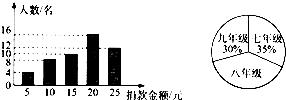

# Mathematics (Grade 6)

**ID**: 6eb7319f
**难度**: hard
**题型**: multiple_choice

## 题目
下面条形图是曙光中学800名学生帮助失学儿童捐款金额的部分抽样调查数据，扇 形图是该校各年级人数比例分布图．那么该校九年级同学捐款的总数大约为（  ）

A．870元
B．4200元
C．5010元
D．250560元

## 解答

**答案**: B

1. Step1:根据条形统计图，计算抽样调查的捐款总数，即5×4 + 10×8 + 15×10 + 20×16 + 25×12 = 20 + 80 + 150 + 320 + 300 = 870元
2. Step2:计算抽样调查的总人数，即4 + 8 + 10 + 16 + 12 = 50人
3. Step3:计算抽样调查的人均捐款数，870÷50 = 17.4元
4. Step4:根据扇形统计图，计算九年级的人数，800×30% = 800×0.3 = 240人
5. Step5:计算九年级同学捐款的总数，17.4×240 = 4176元，4176元≈4200元

## 知识点

**知识点**:
  - 扇形统计图；以一当五（或以上）的条形统计图．

---
