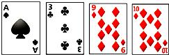

# Mathematics (Grade 6)

**ID**: 71a15567
**难度**: hard
**题型**: multiple_choice

## 题目
选择正确答案的序号填在括号内．
四张扑克牌反扣在桌面上（如图）．甲乙两个小孩玩游戏．甲指一张牌，乙猜是哪一个数．如果乙猜对了，乙获胜，如果乙猜错了甲获胜．那么 $\underline{\hspace{5em}}$ ．
①甲乙获胜的可能性一样大        ②甲一定获得胜利
③甲获胜的可能性大一些          ④乙获胜的可能性大一些．

## 解答

**答案**: ③

1. Step1:明确四张扑克牌上有4个不同数字，这意味着猜数时共有4种情况发生
2. Step2:计算乙获胜的可能性，因为每次只猜1个数字，所以乙获胜可能性为1÷4 = $rac{1}{4}$
3. Step3:计算甲获胜的可能性，用总情况数减去乙获胜的情况数，即甲获胜可能性为(4 - 1)÷4 = $rac{3}{4}$
4. Step4:比较甲乙获胜可能性大小，$rac{1}{4}$＜$rac{3}{4}$，得出甲获胜的可能性大一些

## 知识点

**知识点**:
  - 可能性的大小

---
