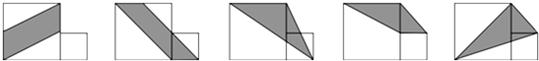

# Mathematics (Grade 6)

**ID**: 7451a456
**难度**: hard
**题型**: multiple_choice

## 题目
大正方形的边长10厘米，小正方形的边长5厘米，下面的图形中阴影部分面积一样大的图形有（  ）

A．2个
B．3个
C．4个
D．5个

## 解答

**答案**: C

1. Step1:对图形进行编号，分别为①②③④⑤
2. Step2:计算图形①阴影部分面积，其为平行四边形，底是10 - 5 = 5厘米，高是10厘米，根据平行四边形面积公式S = 底×高，可得面积为(10 - 5)×10 = 50平方厘米
3. Step3:计算图形②阴影部分面积，其为平行四边形，底是5厘米，高是10厘米，根据平行四边形面积公式S = 底×高，可得面积为5×10 = 50平方厘米
4. Step4:计算图形③阴影部分面积，其为三角形，底是10厘米，高是10厘米，根据三角形面积公式S = 底×高÷2，可得面积为10×10÷2 = 50平方厘米
5. Step5:计算图形④阴影部分面积，其为梯形，上底是5厘米，下底是10厘米，高是10 - 5 = 5厘米，根据梯形面积公式S = (上底 + 下底)×高÷2，可得面积为(10 + 5)×(10 - 5)÷2 = 15×5÷2 = 37.5平方厘米
6. Step6:计算图形⑤阴影部分面积，其为一个长是10 + 5 = 15厘米，宽是10厘米的长方形的面积，减去3个直角三角形的面积，即(10 + 5)×10 - 10×10÷2 - (10 + 5)×5÷2 - 5×5÷2 = 150 - 50 - 37.5 - 12.5 = 50平方厘米
7. Step7:比较各图形阴影部分面积，得出图形①②③⑤的面积相等，一共有4个

## 知识点

**知识点**:
  - 组合图形的面积；面积及面积的大小比较．

---
