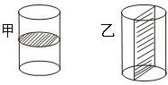

# Mathematics (Grade 6)

**ID**: 7664f4df
**难度**: hard
**题型**: multiple_choice

## 题目
如图是两个同学对同一个圆柱的两种不同的切分，此圆柱（平均分成两块）的侧面沿高剪开正好得到一个正方形，（  ）种分法的截面积大．
A．甲
B．乙
C．无法确定

## 解答

**答案**: B

1. Step1:分析甲种切割方法，其截面和圆柱底面相同，设底面半径为r，根据圆的面积公式可得其面积为πr²
2. Step2:分析乙种切割方法，其截面是以底面直径和高为边长的长方形，因为圆柱侧面沿高剪开是正方形，所以底面周长与高相等，底面半径为r时，高为2πr，底面直径为2r，根据长方形面积公式可得其截面面积为2r×2πr = 4πr²
3. Step3:比较甲、乙两种切割方法所得截面面积大小，因为πr²＜4πr²，所以乙种分法的截面积大，答案选B

## 知识点

**知识点**:
  - 简单的立方体切拼问题．

---
