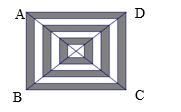

# Mathematics (Grade 6)

**ID**: 7999f6bf
**难度**: hard
**题型**: multiple_choice

## 题目
将长方形 ABCD 对角线平均分成 12 段，连接成右图，长方形 ABCD 内部空白部分面积总和是 10 平方厘米，那么阴影部分面积总和是（     ）平方厘米．

$\begin{description}
\item A．14\item B．16\item C．18\item D．20
\end{description}$

## 解答

**答案**: A

1. Step1:明确大长方形被分成六个小长方形，且根据相似模型可知这些小长方形长和宽的长度比依次为1:2:3:4:5:6
2. Step2:计算空白部分面积表达式为1²+（3² - 2²）+（5² - 4²），阴影部分面积表达式为（2² - 1²）+（4² - 3²）+（6² - 5²）
3. Step3:分别计算空白部分面积为1 + (9 - 4) + (25 - 16) = 1 + 5 + 9 = 15，阴影部分面积为(4 - 1) + (16 - 9) + (36 - 25) = 3 + 7 + 11 = 21
4. Step4:得出空白部分与阴影部分的面积比为15:21 = 5:7
5. Step5:已知空白部分面积总和是10平方厘米，根据面积比计算阴影部分面积总和为10÷5×7 = 14平方厘米
6. Step6:得出答案为A

## 知识点

**知识点**:
  - 小学数学;数学竞赛;几何图形相关问题;平面几何;巧求面积

---
