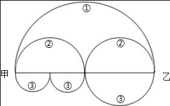

# Mathematics (Grade 6)

**ID**: 7a3b12dd
**难度**: hard
**题型**: multiple_choice

## 题目
(2010•文山县)小华要从甲地到乙地，现有三种线路可供选择，下列说法正确的是(  )

A．①最长
B．②最长
C．③最长
D．一样长

## 解答

**答案**: D

1. Step1:设最小的半圆的直径是1，则稍大一些的半圆的直径就是2，最大的半圆的直径就是4
2. Step2:计算第一种路线长度，第一种路线是直径为4的半圆弧长，根据圆的周长公式C = πd（d为直径），半圆弧长为4π÷2 = 2π
3. Step3:计算第二种路线长度，第二种路线是2个直径为2的半圆的弧长之和，每个直径为2的半圆弧长为2π÷2，所以第二种路线长度为2π÷2 + 2π÷2 = 2π
4. Step4:计算第三种路线长度，第三种路线是直径为1的两个半圆的弧长与直径为2的半圆的弧长之和，直径为1的半圆弧长为1π÷2，所以第三种路线长度为1π÷2 + 1π÷2 + 2π÷2 = 2π
5. Step5:比较三种路线长度，发现三种路线长度均为2π，所以三种路线长度相同，答案选D

## 知识点

**知识点**:
  - 圆、圆环的周长;长度比较．

---
