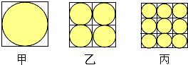

# Mathematics (Grade 6)

**ID**: 7f39e820
**难度**: hard
**题型**: multiple_choice

## 题目
小明有三张同样大小的正方形纸，用下面三种不同的方法分别剪下一些圆形，那么三种剪法中，每张纸的利用率（  ）
$\begin{description}
\item A．甲高\item B．乙高\item C．丙高\item D．一样高
\end{description}$

## 解答

**答案**: D

1. Step1:设正方形的边长是6厘米
2. Step2:计算正方形的面积为6×6=36平方厘米
3. Step3:计算甲中圆的半径为6÷2=3厘米，进而得出甲用的材料面积为3.14×3²=28.26平方厘米
4. Step4:计算乙中圆的半径为6÷2÷2=1.5厘米，进而得出乙用的材料面积为3.14×1.5²×4=28.26平方厘米
5. Step5:计算丙中圆的半径为6÷3÷2=1厘米，进而得出丙用的材料面积为3.14×1²×9=28.26平方厘米
6. Step6:比较三种剪法用的材料面积，发现均为28.26平方厘米，得出每张纸的利用率一样高，答案为D

## 知识点

**知识点**:
  - 圆、圆环的面积；百分率应用题．

---
