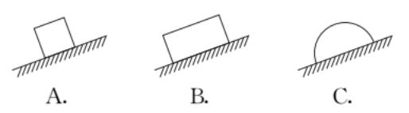

# Mathematics (Grade 6)

**ID**: 81514719
**难度**: hard
**题型**: multiple_choice

## 题目
王大爷家的院子里原有一个用栅栏围成的长5米、宽3米的长方形羊圈.因发展需要现在要用原来的栅栏围成一面靠墙且占地至少达到35平方米的羊圈，应选用（）方案。

## 解答

**答案**: C

1. Step1:根据长方形周长公式，计算原有栅栏长度为(3 + 5)×2 = 16米
2. Step2:计算方案A（假设为正方形），边长为16÷3 = 16/3米，面积为(16/3)×(16/3)=256/9 = 28 4/9平方米，28 4/9＜35
3. Step3:计算方案B（假设长方形长8米，宽4米），面积为8×4 = 32平方米，32＜35
4. Step4:计算方案C（半圆形），半圆弧长16米，半径为16/π米，面积为1/2×π×(16/π)² = 128/π平方米，128/π＞35
5. Step5:比较三种方案面积与35平方米的大小关系，得出只有半圆形面积大于35平方米，所以选C

## 知识点

**知识点**:
  - 圆的面积;长方形与正方形的面积;长方形与正方形的周长

---
