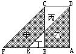

# Mathematics (Grade 6)

**ID**: 86909329
**难度**: hard
**题型**: multiple_choice

## 题目
如图，四边形ABCD为长方形，四边形CDEF为平行四边形．下面四种说法中正确的是(  )
A．甲的面积比乙的面积大
B．甲的面积比乙的面积小
C．只有当丙、丁两部分面积相等时，甲、乙两部分面积才相等
D．甲、乙两部分面积总是相等的，与丙、丁两部分面积的大小无关

## 解答

**答案**: D

1. Step1:因为四边形ABCD为长方形，所以得出BC=AD，AB=CD
2. Step2:由于四边形CDEF为平行四边形，所以得到CD=EF，进而推出AB=EF
3. Step3:在AB=EF两边同时加上BE，得出BF=AE
4. Step4:依据等底等高的三角形面积相等，可知三角形CBF的面积=三角形DAE的面积
5. Step5:因为丁是三角形CBF和三角形DAE的公共部分，所以三角形CBF的面积-丁的面积=三角形DAE的面积-丁的面积，即甲、乙两部分面积总是相等，与丙、丁两部分面积的大小无关
6. Step6:根据上述推导，从选项中选择D

## 知识点

**知识点**:
  - 面积及面积的大小比较．

---
