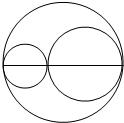

# Mathematics (Grade 6)

**ID**: 9126b9bd
**难度**: hard
**题型**: multiple_choice

## 题目
图中的两个小圆的周长的和与大圆的周长比较，（  ）
$\begin{description}
\item A．一样长\item B．大圆的周长长\item C．大圆的周长短\item D．无法比较
\end{description}$

## 解答

**答案**: A

1. Step1:设大圆的半径是R，两个小圆的半径分别为r1和r2
2. Step2:根据圆的周长公式C = 2πr，得出大圆的周长C = 2πR
3. Step3:根据圆的周长公式C = 2πr，得出两个小圆的周长分别为2πr1和2πr2，其周长和为2πr1 + 2πr2
4. Step4:对2πr1 + 2πr2进行变形，得到2π(r1 + r2)
5. Step5:由图可知R = r1 + r2
6. Step6:将R = r1 + r2代入大圆周长公式2πR，得到2πR = 2π(r1 + r2)，即两个小圆的周长和等于大圆的周长
7. Step7:所以图中的两个小圆的周长的和与大圆的周长相等，答案选A

## 知识点

**知识点**:
  - 圆、圆环的周长．

---
