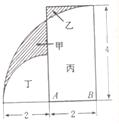

# Mathematics (Grade 6)

**ID**: 92131e04
**难度**: hard
**题型**: multiple_choice

## 题目
如图，A，B是两个圆的圆心，那么两个阴影部分甲、乙的面积差是（  ）
A．3.14
B．1.42
C．0.852
D．1.3

## 解答

**答案**: B

1. Step1:明确长方形的长是4，宽是2，大扇形半径是4，小扇形半径是2
2. Step2:设长方形图中空白部分的面积为a
3. Step3:计算大阴影部分甲的面积为$\frac{1}{4}$×3.14×4$^{2}−\frac{1}{4}$×3.14×2$^{2}$-a，即(12.56 - 3.14 - a)=(9.42 - a)
4. Step4:计算小阴影部分乙的面积为2×4 - a，即8 - a
5. Step5:计算两个阴影部分甲、乙的面积差为(9.42 - a) - (8 - a) = 9.42 - 8 = 1.42

## 知识点

**知识点**:
  - 组合图形的面积．

---
