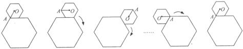

# Mathematics (Grade 6)

**ID**: 98affb59
**难度**: hard
**题型**: multiple_choice

## 题目
如下图所示，小正六边形沿着大正六边形的边，按顺时针方向滚动．小正六边形的边长是大正六边形的一半．如果小正六边形沿着大正六边形的边滚动了一周后返回到出发点的位置，那么这个过程中线段OA围绕着O点旋转了(  )圈．(O点是小正六边形的中心)

A．1
B．2
C．3
D．4

## 解答

**答案**: B

1. Step1:明确小正六边形边长是大正六边形边长的一半
2. Step2:分析得出小正六边形转动一圈需要大正六边形的3条边
3. Step3:因为大正六边形有6条边，所以小正六边形沿着大正六边形滚动一周需转动2圈
4. Step4:由小正六边形转动的圈数即是线段OA转动的圈数，得出线段OA围绕着O点旋转了2圈

## 知识点

**知识点**:
  - 圆、圆环的周长．

---
