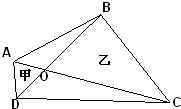

# Mathematics (Grade 6)

**ID**: 99ee3eb8
**难度**: hard
**题型**: multiple_choice

## 题目
如图所示，BO=2DO、CO=5AO，甲、乙面积和是11平方厘米．ABCD四边形的面积是（  ）平方厘米．
A．16
B．18
C．20
D．22

## 解答

**答案**: B

1. Step1:由BO=2DO，得出DO：OB=1：2，根据高一定时三角形面积与底成正比例，得到甲的面积：△AOB的面积=1：2
2. Step2:由CO=5AO，得出AO：OC=1：5，根据高一定时三角形面积与底成正比例，得到△AOB的面积：乙的面积=1：5=2：10
3. Step3:由前面步骤推出甲的面积：乙的面积=1：10，结合甲、乙面积和是11平方厘米，算出甲的面积=1平方厘米，乙的面积=10平方厘米
4. Step4:根据甲的面积：△AOB的面积=1：2，算出△AOB的面积=1×2=2平方厘米
5. Step5:根据AO：OC=1：5，得出甲的面积：△DOC的面积=1：5，算出△DOC的面积=1×5=5平方厘米
6. Step6:计算四边形ABCD的面积为1+10+2+5=18平方厘米

## 知识点

**知识点**:
  - 三角形面积与底的正比关系；组合图形的面积．

---
