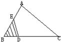

# Mathematics (Grade 6)

**ID**: 9a59fba1
**难度**: hard
**题型**: multiple_choice

## 题目
下面说法正确的有（  ）个
（1）真分数的倒数大于它本身．
（2）把10克盐放入100克水中配成盐水，盐水的含盐率等于10%．
（3）苹果比香蕉多$\frac{1}{3}$，则香蕉比苹果少25%；
（4）水结成冰后体积增加$\frac{1}{11}$，那么冰化成水后体积减少$\frac{1}{12}$．
（5）面积相等的正方形和圆，正方形的周长小．
（6）图中AE：EB=1：1，BD：BC=1：5，阴影面积是12cm$^{2}$，则空白部分的面积是108cm$^{2}$．
$\begin{description}
\item A．2个\item B．3个\item C．4个\item D．5个
\end{description}$

## 解答

**答案**: C

1. Step1:分析（1），根据倒数定义，真分数小于1，其倒数大于1，所以真分数的倒数大于它本身，此说法正确
2. Step2:分析（2），计算含盐率为10÷(10 + 100)×100%≈9.1%，不等于10%，此说法错误
3. Step3:分析（3），苹果比香蕉多$rac{1}{3}$，即苹果是香蕉的$rac{4}{3}$，则香蕉比苹果少$(rac{4}{3}-1)\divrac{4}{3}=25\%$，此说法正确
4. Step4:分析（4），设水的体积是11，水结成冰后体积是11×(1 + $rac{1}{11}$)=12，冰化成水后体积减少(12 - 11)÷12=$rac{1}{12}$，此说法正确
5. Step5:分析（5），面积相等的正方形和圆，正方形的周长大于圆的周长，此说法错误
6. Step6:分析（6），由AE：EB=1：1，BD：BC=1：5可得BD：BC=1：6，根据三角形面积关系可知空白部分面积是108cm²，此说法正确
7. Step7:统计正确说法的个数为4个，所以答案选C

## 知识点

**知识点**:
  - 倒数的认识；分数四则复合应用题；百分数的实际应用；正方形的周长；圆、圆环的周长；组合图形的面积．

---
