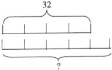

# Mathematics (Grade 6)

**ID**: 9b360d6a
**难度**: hard
**题型**: multiple_choice

## 题目
正确的算式是（  ）

$\begin{description}
\item A．32×\frac{1}{4}\item B．32×（1+\frac{1}{4}）\item C．x×（1+\frac{1}{4}）=32
\end{description}$

## 解答

**答案**: B

1. Step1:分析选项A，32×rac{1}{4}表示32的rac{1}{4}，与题目所求不符
2. Step2:分析选项B，根据解析2中方法一，把32看成单位“1”，要求的数量是它的（1+rac{1}{4}），用32乘上这个分率32×（1+rac{1}{4}）就是要求的数量，符合题意
3. Step3:分析选项C，x×（1+rac{1}{4}）=32是用方程表示数量关系，并非直接的算式，不符合题目问的正确算式的要求
4. Step4:综上，正确答案是B

## 知识点

**知识点**:
  - 图文应用题；分数乘法应用题；分数除法应用题．

---
