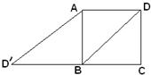

# Mathematics (Grade 6)

**ID**: 9c6cd3df
**难度**: hard
**题型**: multiple_choice

## 题目
如图，已知正方形ABCD的边长为2，如果将线段BD绕着点B旋转后，点D落在CB的延长线上的D处，那么AD′为（  ）
$\begin{description}
\item A．2\sqrt{3}\item B．2\sqrt{2}\item C．\sqrt{7}\item D．\sqrt{10}
\end{description}$

## 解答

**答案**: A

1. Step1:根据正方形边长为2，在直角三角形BCD中，由勾股定理BD = √(BC² + CD²)，因为BC = CD = 2，所以BD = √(2² + 2²) = 2√2
2. Step2:因为线段BD绕点B旋转后，点D落在CB延长线上的D'处，所以BD' = BD = 2√2
3. Step3:在直角三角形ABD'中，AB = 2，BD' = 2√2，根据勾股定理AD' = √(AB² + BD'²) = √((2√2)² + 2²) = 2√3
4. Step4:对比选项，得出答案为A

## 知识点

**知识点**:
  - 长方形、正方形的面积．

---
