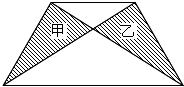

# Mathematics (Grade 6)

**ID**: 9cea0a42
**难度**: hard
**题型**: multiple_choice

## 题目
如图等腰梯形中，两个阴影部分面积相比（  ）

A．甲大
B．乙大
C．一样大
D．没法比

## 解答

**答案**: C

1. Step1:观察图形，确定甲和丙组成一个三角形，乙和丙也组成一个三角形
2. Step2:根据等腰梯形的性质，得出甲和丙组成的三角形与乙和丙组成的三角形等底等高
3. Step3:依据三角形面积公式，等底等高的三角形面积相等，所以甲和丙组成的三角形面积与乙和丙组成的三角形面积相等
4. Step4:因为两个组合三角形都包含丙部分，将两个组合三角形的面积都减去丙的面积
5. Step5:得出甲的面积等于乙的面积，所以答案选C

## 知识点

**知识点**:
  - 面积及面积的大小比较．

---
