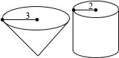

# Mathematics (Grade 6)

**ID**: 9d70a4c1
**难度**: hard
**题型**: multiple_choice

## 题目
有两个等高的容器（如图），圆锥体容器的底面半径为3分米，圆柱体容器的底面半径是2分米．先将圆锥容器装满水，再把水全部倒入圆柱体容器内，这时水深比容器高度的$\frac{7}{8}$低1分米．圆柱体容器的容积是（  ）立方分米．
A．36π
B．32π
C．24π
D．18π

## 解答

**答案**: B

1. Step1:设容器的高为x分米
2. Step2:根据圆锥体积公式V = $\frac{1}{3}$πr²h，其中r = 3分米，h = x分米，得出圆锥体容器内水的体积为$\frac{1}{3}$×π×3×3×x
3. Step3:根据圆柱体积公式V = πr²h，其中r = 2分米，h = ($\frac{7}{8}$x - 1)分米，得出水在圆柱中的体积为π×2×2×（$\frac{7}{8}$x - 1)
4. Step4:因为水的体积不变，所以列出方程$\frac{1}{3}$×π×3×3×x = π×2×2×（$\frac{7}{8}$x - 1)
5. Step5:对方程$\frac{1}{3}$×π×3×3×x = π×2×2×（$\frac{7}{8}$x - 1)进行化简，得到3πx - π×$\frac{7}{2}$x + 4×π = 0
6. Step6:继续化简方程3πx - π×$\frac{7}{2}$x + 4×π = 0，得出$\frac{1}{2}$πx = 4π
7. Step7:求解方程$\frac{1}{2}$πx = 4π，得到x = 8
8. Step8:根据圆柱体积公式V = πr²h，其中r = 2分米，h = 8分米，计算圆柱体容器的容积为π×2×2×8 = 32π立方分米

## 知识点

**知识点**:
  - 圆柱的侧面积、表面积和体积；圆锥的体积．

---
