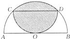

# Mathematics (Grade 6)

**ID**: 9ed0c1ef
**难度**: hard
**题型**: multiple_choice

## 题目
如图，曲线ACDB和COD是两个半圆，CD平行于AB，大半圆的半径是1米，那么阴影部分的面积是（  ）
A．$\frac{π−1}{2}$
B．$\frac{3π}{4}$−$\frac{1}{2}$
C．1
D．$\frac{π}{2}$

## 解答

**答案**: A

1. Step1:连接CO和DO，因为大半圆半径为1米，以CD为边长的正方形面积为2平方米，所以可得$\frac{1}{2}$CD的平方等于$\frac{1}{2}$，进而得到阴影部分半圆半径的平方为$\frac{1}{2}$，根据圆的面积公式S = πr²，可算出阴影部分半圆面积为π×$\frac{1}{2}$×$\frac{1}{2}$=$\frac{1}{4}$π
2. Step2:因为∠COD = 90°，根据扇形面积公式S=$\frac{n}{360}$×πr²（n为圆心角度数，r为半径），可算出$\frac{1}{4}$圆的面积为$\frac{90}{360}$×π×1²=$\frac{1}{4}$π，又因为△COD的面积为1×1×$\frac{1}{2}$=$\frac{1}{2}$平方米，所以上面阴影面积为$\frac{1}{4}$π - $\frac{1}{2}$
3. Step3:将阴影部分半圆面积与上面阴影面积相加，即$\frac{1}{4}$π + $\frac{1}{4}$π - $\frac{1}{2}$=$\frac{π - 1}{2}$，得到阴影部分总面积，所以答案选A

## 知识点

**知识点**:
  - 组合图形的面积．

---
