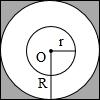

# Mathematics (Grade 6)

**ID**: a990e929
**难度**: hard
**题型**: multiple_choice

## 题目
如图，已知：R：r=2：1且圆环面积为471cm$^{2}$，则阴影部分面积是（  ）

A．628cm$^{2}$
B．314cm$^{2}$
C．172cm$^{2}$
D．157cm$^{2}$

## 解答

**答案**: C

1. Step1:由R：r=2：1，根据圆的面积公式S = πr²，可得大圆的面积：小圆的面积=4：1
2. Step2:已知圆环面积为471cm²，圆环面积是大圆面积减去小圆面积，所以小圆的面积是471÷（4 - 1）=157平方厘米
3. Step3:由小圆面积求出大圆的面积为157×4=628平方厘米
4. Step4:根据圆的面积公式S = πR²，由大圆面积628平方厘米可得R²=628÷3.14=200
5. Step5:因为正方形的边长等于2R，所以正方形的面积是2R×2R=4R²
6. Step6:将R²=200代入正方形面积公式，可得正方形的面积为4×200=800平方厘米
7. Step7:阴影部分的面积等于正方形的面积减去大圆的面积，即800 - 628=172平方厘米

## 知识点

**知识点**:
  - 组合图形的面积．

---
