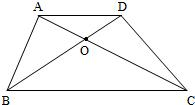

# Mathematics (Grade 6)

**ID**: ad8d0292
**难度**: hard
**题型**: multiple_choice

## 题目
如图，梯形ABCD中共有（  ）对面积相等的三角形

A．\%22
B．3
C．4
D．5

## 解答

**答案**: B

1. Step1:根据三角形面积公式S=$\frac{1}{2}$×底×高，可知等底同高的三角形面积相等。观察图形，发现△ABD与△ACD等底同高，所以$S_{△ABD}$=$S_{△ACD}$
2. Step2:继续观察图形，△ABC与△DBC等底同高，所以$S_{△ABC}$=$S_{△DBC}$
3. Step3:由$S_{△ABO}$=$S_{△ABC}$-$S_{△BOC}$，$S_{△DOC}$=$S_{△DBC}$-$S_{△BOC}$，因为$S_{△ABC}$=$S_{△DBC}$，进行等量代换可得$S_{△ABO}$=$S_{△DOC}$
4. Step4:综上，有△ABD与△ACD、△ABC与△DBC、△ABO与△DOC这3对面积相等的三角形，所以答案是B

## 知识点

**知识点**:
  - 三角形面积与底的正比关系．

---
