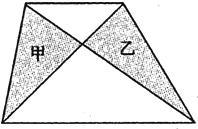

# Mathematics (Grade 6)

**ID**: ba468ed5
**难度**: hard
**题型**: multiple_choice

## 题目
如图梯形中，阴影部分甲与乙大小关系是（  ）

A．甲＞乙
B．甲＜乙
C．甲=乙

## 解答

**答案**: C

1. Step1:观察图形可知，梯形中AB和CD平行
2. Step2:因为三角形ABC和三角形ABD等底等高，根据三角形面积公式，等底等高的三角形面积相等，所以三角形ABC和三角形ABD面积相等
3. Step3:由于三角形ABE是三角形ABC和三角形ABD的公共部分，那么S△ABC - S△ABE = S△ABD - S△ABE
4. Step4:由S△ABC - S△ABE = S△ABD - S△ABE，可推出三角形AEC（即阴影部分甲）和三角形BED（即阴影部分乙）面积相等
5. Step5:所以两块阴影部分甲与乙的面积相等，答案选C

## 知识点

**知识点**:
  - 面积及面积的大小比较．

---
