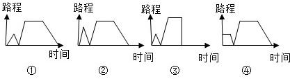

# Mathematics (Grade 6)

**ID**: c657b1ae
**难度**: hard
**题型**: multiple_choice

## 题目
芳芳从家出发去看电影．当她走了着约一半的路程时，发现没带电影票，于是她立刻跑回家取票，之后又赶紧跑到电影院，看完电影，再走回家．下面图（  ）符合题目中所描述的情况．

$\begin{description}
\item A．①\item B．②\item C．③\item D．④
\end{description}$

## 解答

**答案**: A

1. Step1:芳芳从家出发走了大约一半路程，此时离家距离从0开始逐渐增加到最远距离的一半
2. Step2:发现没带票跑回家，离家距离从最远距离的一半逐渐减小到0
3. Step3:在家取票，有一段时间离家距离保持为0
4. Step4:再跑去电影院，离家距离从0开始逐渐增加到最远距离，且因为是跑步速度比返回时快
5. Step5:在电影院看电影，有一段时间离家距离保持在最远距离
6. Step6:看完电影回家，离家距离从最远距离逐渐减小到0
7. Step7:根据上述分析，符合这种离家距离变化情况的是图①，所以答案是A

## 知识点

**知识点**:
  - 单式折线统计图．

---
