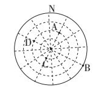

# Mathematics (Grade 6)

**ID**: c6b89e72
**难度**: hard
**题型**: multiple_choice

## 题目
如图是飞机场的雷达屏幕，以机场为观测点，飞机A在北偏东30°方向距离机场20千米处。下面的描述错误的是（）。

A.飞机B在南偏东60°方向距离机场40千米处
B.飞机C在南偏西30°方向距离机场10千米处
C.飞机D在北偏东30°方向距离机场20千米处
D.飞机D在北偏西60°方向距离机场20千米处

## 解答

**答案**: C

1. Step1:明确以机场为观测点，根据飞机A位置信息，得出整个圆被平均分成12份，每份圆心角30°，一个单位长度是10千米
2. Step2:观察图形，判断飞机B在南偏东60°方向距离机场40千米处，A选项描述正确
3. Step3:观察图形，判断飞机C在南偏西30°方向距离机场10千米处，B选项描述正确
4. Step4:观察图形，判断飞机D在北偏西60°方向距离机场20千米处，C选项描述错误，D选项描述正确
5. Step5:得出描述错误的是C选项

## 知识点

**知识点**:
  - 根据方向和距离确定位置;辨认方向

---
