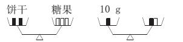

# Mathematics (Grade 6)

**ID**: c6bd7915
**难度**: hard
**题型**: multiple_choice

## 题目
如图彤彤拿了一个天平，测量饼干和糖果的质量（每块饼干质量相同，每颗糖果质量相同），第一次，左盘放两块饼干，右盘放三颗糖果，结果天平平衡；第二次，左盘放10g砝码，右盘放一块饼干和一颗糖果，结果天平平衡；第三次，左盘放一颗糖果，右盘放一块饼干。下列能使天平再次平衡的方法是（）。

A.在放糖果的秤盘上加2g砝码
B.在放饼干的秤盘上加2g砝码
C.在放糖果的秤盘上加5g砝码
D.在放饼干的秤盘上加5g砝码

## 解答

**答案**: A

1. Step1:根据第一次天平平衡，可知2块饼干的重量等于3颗糖果的重量，由此推出1块饼干的重量等于1.5颗糖果的重量
2. Step2:依据第二次天平平衡，得出1块饼干的重量加上1颗糖果的重量等于10g
3. Step3:把1块饼干的重量等于1.5颗糖果的重量代入到1块饼干的重量加上1颗糖果的重量等于10g中，得到1.5颗糖果的重量加上1颗糖果的重量等于10g
4. Step4:计算得出1颗糖果的重量是4g
5. Step5:根据1块饼干的重量等于1.5颗糖果的重量，算出1块饼干的重量是6g
6. Step6:比较1块饼干和1颗糖果的重量，得出1块饼干的重量等于1颗糖果的重量加上2g
7. Step7:判断能使第三次天平平衡的方法是在放糖果的秤盘上加2g砝码，对应选项A

## 知识点

**知识点**:
  - 简单的等量代换问题

---
