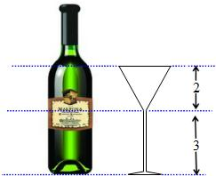

# Mathematics (Grade 6)

**ID**: ccfd16b4
**难度**: hard
**题型**: multiple_choice

## 题目
如图，酒瓶中装有一些酒，倒进一只酒杯中，酒杯的直径是酒瓶的一半，共能倒满（  ）
$\begin{description}
\item A．10 杯\item B．15杯\item C．20杯\item D．30杯
\end{description}$

## 解答

**答案**: D

1. Step1:设酒杯的半径是r，高是h
2. Step2:根据圆锥体积公式，计算酒杯的容积为$rac{1}{3}$πr$^{2}$h
3. Step3:因为酒杯的直径是酒瓶的一半，所以酒瓶半径是酒杯半径的2倍，即酒瓶半径为2r
4. Step4:由图可知酒瓶中酒的高度对应的份数为1 + $rac{3}{2}$，根据圆柱体积公式，计算酒瓶中酒的体积为π（2r）$^{2}$h×（1 + $rac{3}{2}$）=10πr$^{2}$h
5. Step5:用酒瓶中酒的体积除以酒杯的容积，即（10πr$^{2}$h）÷$rac{1}{3}$πr$^{2}$h = 30（杯），得到能倒满的杯数为30杯

## 知识点

**知识点**:
  - 圆锥的体积；比的应用；圆柱的侧面积、表面积和体积．

---
