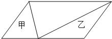

# Mathematics (Grade 6)

**ID**: d04347f6
**难度**: hard
**题型**: multiple_choice

## 题目
如图，甲三角形的面积占平行四边形面积的18%，乙三角形面积是64平方厘米，则平行四边形面积是（  ）
A．100
B．192
C．200
D．256

## 解答

**答案**: C

1. Step1:把平行四边形的面积看作单位“1”，因为甲和乙的面积之和占平行四边形面积的$\frac{1}{2}$，甲三角形的面积占平行四边形面积的18%，所以乙三角形面积占平行四边形面积的百分比为$\frac{1}{2}$ - 18% = 50% - 18% = 32%
2. Step2:已知乙三角形面积是64平方厘米，且乙三角形面积占平行四边形面积的32%，根据已知一个数的百分之几是多少，求这个数用除法，所以平行四边形面积为64÷32% = 200平方厘米

## 知识点

**知识点**:
  - 平行四边形的面积；分数除法应用题．

---
