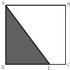

# Mathematics (Grade 6)

**ID**: d2675306
**难度**: hard
**题型**: multiple_choice

## 题目
如图，阴影部分面积与正方形面积比是5：12，正方形的边长是6cm，DE的长是（  ）cm．
A．3
B．3.6
C．4
D．5

## 解答

**答案**: D

1. Step1:根据正方形边长为6cm，利用正方形面积公式S = a²（a为边长），可得正方形面积为6×6 = 36平方厘米
2. Step2:因为阴影部分面积与正方形面积比是5：12，把正方形面积看作单位“1”，所以阴影部分面积为36×$\frac{5}{12}$ = 15平方厘米
3. Step3:由于阴影部分是三角形，其面积公式为S = $\frac{1}{2}$ah（a为底，h为高），这里高为正方形边长6cm，所以三角形的底DE的长度为15×2÷6 = 5厘米

## 知识点

**知识点**:
  - 比的应用；长方形、正方形的面积；三角形的周长和面积．

---
