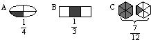

# Mathematics (Grade 6)

**ID**: d37fbc39
**难度**: hard
**题型**: multiple_choice

## 题目
如图，阴影部分用分数表示错误的是（  ）

$\begin{description}
\item A．A\item B．B\item C．C
\end{description}$

## 解答

**答案**: C

1. Step1:分析选项A，将整个椭圆视为单位'1'，其被平均分成4份，阴影部分占1份，根据分数的意义，用分数表示为$rac{1}{4}$，所以A选项正确
2. Step2:分析选项B，把长方形当作单位'1'，平均分成3份，阴影部分占1份，按照分数的意义，用分数表示为$rac{1}{3}$，所以B选项正确
3. Step3:分析选项C，将六边形看作单位'1'，假设平均分成i份，阴影占u份，其分数表示应该是$rac{u}{i}$，而不是$rac{u}{12}$，所以C选项错误
4. Step4:综上，阴影部分用分数表示错误的是C选项

## 知识点

**知识点**:
  - 分数的意义、读写及分类．

---
