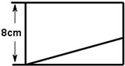

# Mathematics (Grade 6)

**ID**: d4ec1652
**难度**: hard
**题型**: multiple_choice

## 题目
一条线段将一个边长为8cm的正方形分割成一个三角形和一个梯形（如图）．已知梯形面积比三角形面积多40cm$^{2}$，则三角形中较短的直角边的长是(    )cm．

## 解答

**答案**: 3

1. Step1:设三角形中较短的直角边的长是a，则梯形的上底长是8 - a
2. Step2:根据梯形面积公式（上底 + 下底）×高÷2和三角形面积公式底×高÷2，列出方程（8 - a + 8）×8÷2 - 8a÷2 = 40
3. Step3:化简方程左边，(8 - a + 8)×8÷2 - 8a÷2=(16 - a)×4 - 4a=64 - 4a - 4a=64 - 8a，得到64 - 8a = 40
4. Step4:方程两边同时加8a，得到64 = 40 + 8a
5. Step5:方程两边同时减40，得到24 = 8a
6. Step6:方程两边同时除以8，得到a = 3

## 知识点

**知识点**:
  - 三角形的周长和面积；长方形、正方形的面积．

---
