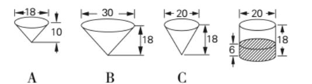

# Mathematics (Grade 6)

**ID**: dc552c8d
**难度**: hard
**题型**: multiple_choice

## 题目
小明做了一个圆柱形的容器和三个圆锥形的容器（如下图），若要将圆柱形容器中的水倒入圆锥形的容器中，正好倒满的是（）。

## 解答

**答案**: C

1. Step1:根据圆柱体积公式$V = S_{底}h=\pi(\frac{d}{2})^{2}h$，其中$d = 20$，$h = 6$，计算圆柱形容器中水的体积为$3.14×(20÷2)^{2}×6 = 1884(cm^{3})$
2. Step2:根据圆锥体积公式$V=\frac{1}{3}S_{底}h=\frac{1}{3}\pi(\frac{d}{2})^{2}h$，计算A选项圆锥体积，$d = 18$，$h = 16$，则$V_{A}=\frac{1}{3}×3.14×(18÷2)^{2}×16 = 1356.48(cm^{3})$
3. Step3:根据圆锥体积公式$V=\frac{1}{3}S_{底}h=\frac{1}{3}\pi(\frac{d}{2})^{2}h$，计算B选项圆锥体积，$d = 30$，$h = 18$，则$V_{B}=\frac{1}{3}×3.14×(30÷2)^{2}×18 = 4239(cm^{3})$
4. Step4:根据圆锥体积公式$V=\frac{1}{3}S_{底}h=\frac{1}{3}\pi(\frac{d}{2})^{2}h$，计算C选项圆锥体积，$d = 20$，$h = 18$，则$V_{C}=\frac{1}{3}×3.14×(20÷2)^{2}×18 = 1884(cm^{3})$
5. Step5:比较水的体积与各圆锥体积，因为$V_{C}$等于水的体积，所以圆柱形容器中的水倒入C的圆锥形容器正好可以倒满，答案为C

## 知识点

**知识点**:
  - 圆锥的体积;圆柱的体积

---
