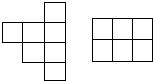

# Mathematics (Grade 6)

**ID**: dee8732e
**难度**: hard
**题型**: multiple_choice

## 题目
如图两图都是用1平方厘米的正方形拼成的，两个图比较（  ）

A．面积相等，周长也相等
B．面积相等，周长不相等
C．面积不相等，周长也不相等
D．面积不相等，周长相等

## 解答

**答案**: C

1. Step1:观察第一个图形，发现它是由7个1平方厘米的小正方形组成，根据面积计算方法，可得其面积为7×1 = 7平方厘米
2. Step2:把第一个图形的周长看作长4厘米、宽3厘米的长方形的周长，根据长方形周长公式（长 + 宽）×2，可得其周长为(4 + 3)×2 = 14厘米
3. Step3:观察第二个图形，发现它是由6个1平方厘米的小正方形组成，所以其面积为6×1 = 6平方厘米
4. Step4:把第二个图形的周长看作长3厘米、宽2厘米的长方形的周长，根据长方形周长公式可得其周长为(3 + 2)×2 = 10厘米
5. Step5:比较两个图形的面积，7平方厘米不等于6平方厘米，面积不相等；比较两个图形的周长，14厘米不等于10厘米，周长也不相等，所以答案选C

## 知识点

**知识点**:
  - 图形的拼组；面积及面积的大小比较．

---
