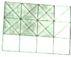

# Mathematics (Grade 6)

**ID**: e4fca1ed
**难度**: hard
**题型**: multiple_choice

## 题目
图中画斜格子的阴影部分用算式表示为（  ）

A．$\frac{1}{3}$×$\frac{3}{4}$
B．$\frac{2}{3}$×$\frac{3}{4}$
C．$\frac{3}{4}$×$\frac{3}{4}$

## 解答

**答案**: B

1. Step1:观察图形，将长方形看作整体，发现其被平均分成3份，左斜线部分占了其中2份，所以左斜线部分占长方形的比例为$\frac{2}{3}$
2. Step2:针对左斜线部分，又将其平均分成4份，右斜线部分占了其中3份，即右斜线部分占左斜线部分的$\frac{3}{4}$
3. Step3:因为左斜线部分占长方形的$\frac{2}{3}$，右斜线部分占左斜线部分的$\frac{3}{4}$，所以阴影部分（左斜线和右斜线相交部分）占长方形的比例为$\frac{2}{3}×\frac{3}{4}$
4. Step4:对比选项，与$\frac{2}{3}×\frac{3}{4}$对应的是选项B

## 知识点

**知识点**:
  - 分数乘法．

---
