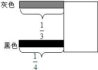

# Mathematics (Grade 6)

**ID**: e6536979
**难度**: hard
**题型**: multiple_choice

## 题目
图中有两张纸条，一边被一张纸压住了，你认为（  ）一条纸条长一些．

A．灰色纸条长
B．黑色纸条长
C．一样长
D．无法比较

## 解答

**答案**: B

1. Step1:根据题目可知灰色纸条露出部分占灰色纸条总长的$\frac{1}{4}$，黑色纸条露出部分占黑色纸条总长的$\frac{1}{3}$，且露出部分长度相等，即灰色纸条的$\frac{1}{4}$和黑色纸条的$\frac{1}{3}$一样长
2. Step2:比较$\frac{1}{3}$和$\frac{1}{4}$的大小，因为分子相同，分母越大分数越小，所以$\frac{1}{3}>\frac{1}{4}$
3. Step3:由于灰色纸条的$\frac{1}{4}$和黑色纸条的$\frac{1}{3}$一样长，且$\frac{1}{3}>\frac{1}{4}$，那么说明黑色纸条整体长度更长
4. Step4:根据上述推理，从选项中选择B选项

## 知识点

**知识点**:
  - 分数大小的比较．

---
