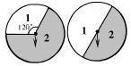

# Mathematics (Grade 6)

**ID**: e8b308bd
**难度**: hard
**题型**: multiple_choice

## 题目
如图是两个可以自由转动的转盘，每个转盘被分成两个扇形，同时转动两个转盘，转盘停止后，指针所指区域内的数字之和为4的可能性是(  )
A．$\frac{1}{2}$
B．$\frac{1}{3}$
C．$\frac{1}{4}$
D．$\frac{1}{5}$

## 解答

**答案**: B

1. Step1:分析图(1)，圆的圆心角为360度，空白部分扇形圆心角为120度，阴影部分扇形圆心角为240度，在同一圆中，根据面积与圆心角的关系，可得指针指向图(1)中2的可能性为240÷360 = $\frac{2}{3}$
2. Step2:分析图(2)，指针指向图(2)中2的可能性是$\frac{1}{2}$
3. Step3:要使指针所指区域内数字之和为4，则需图(1)指向2且图(2)指向2，根据独立事件概率计算方法，两者同时发生的概率为各自发生概率的乘积，即指针所指区域内数字之和为4的可能性是$\frac{2}{3}×\frac{1}{2}=\frac{1}{3}$
4. Step4:对比选项，答案为B

## 知识点

**知识点**:
  - 简单事件发生的可能性求解．

---
