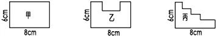

# Mathematics (Grade 6)

**ID**: e954c5cb
**难度**: hard
**题型**: multiple_choice

## 题目
甲乙丙三张图的周长相比，（  ）

$\begin{description}
\item A．甲最长\item B．乙最长\item C．丙最长
\end{description}$

## 解答

**答案**: B

1. Step1:计算甲的周长，根据长方形周长公式 C=(长 + 宽)×2，甲图长为 8cm，宽为 6cm，所以甲的周长为(8 + 6)×2 = 14×2 = 28cm
2. Step2:分析乙的周长，乙图在甲图周长基础上，凹陷部分的两条边 a 和 b 也属于乙的周长，所以乙的周长为(8 + 6)×2 + a + b = 28 + a + b cm
3. Step3:计算丙的周长，通过平移丙图的边，可将其周长转化为和甲图同样的长方形周长，即(8 + 6)×2 = 28cm
4. Step4:比较甲乙丙的周长，甲的周长为 28cm，丙的周长为 28cm，乙的周长为 28 + a + b cm，因为 a 和 b 为正数，所以乙的周长大于甲和丙的周长

## 知识点

**知识点**:
  - 长度比较．

---
