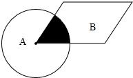

# Mathematics (Grade 6)

**ID**: f0430610
**难度**: hard
**题型**: multiple_choice

## 题目
如图，阴影部分的面积是圆的面积的$\frac{1}{6}$，是平行四边形面积的$\frac{1}{8}$，那么图中A与B的面积比是（  ）
$\begin{description}
\item A．\frac{1}{6}：\frac{1}{8}\item B．4：3\item C．3：4\item D．5：7
\end{description}$

## 解答

**答案**: D

1. Step1:根据“阴影部分的面积是圆的面积的$rac{1}{6}$，将圆的面积看作6份，那么阴影部分面积是1份，所以A的面积为6 - 1 = 5份
2. Step2:依据“阴影部分的面积是平行四边形面积的$rac{1}{8}$，把平行四边形面积看作8份，阴影部分面积是1份，所以B的面积为8 - 1 = 7份
3. Step3:得出A与B的面积比为5 : 7

## 知识点

**知识点**:
  - 比的意义；分数的意义、读写及分类．

---
