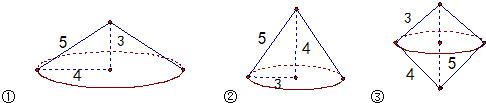

# Mathematics (Grade 6)

**ID**: f4c74b96
**难度**: hard
**题型**: multiple_choice

## 题目
一个直角三角形的三条边的长度是3、4和5．如果分别以各边为轴旋转一周，得到三个立体图形（如图）．比较这三个立体图形的体积（  ）

$\begin{description}
\item A．①的体积最小\item B．②的体积最小\item C．③的体积最小\item D．一样大
\end{description}$

## 解答

**答案**: C

1. Step1:根据圆锥体积公式v=$rac{1}{3}$sh，计算①以3为轴旋转一周得到的立体图形体积，即$rac{1}{3}×$3.14×4$^{2}$×3=$rac{1}{3}×$3.14×16×3=50.24立方单位
2. Step2:根据圆锥体积公式v=$rac{1}{3}$sh，计算②以4为轴旋转一周得到的立体图形体积，即$rac{1}{3}×$3.14×3$^{2}$×4=$rac{1}{3}×$3.14×9×4=37.68立方单位
3. Step3:计算③以5为轴旋转一周得到的立体图形的底面半径，由3×4÷2×2÷5=2.4得到，且两个圆锥高的和是5，再根据圆锥体积公式计算其体积，即$rac{1}{3}$×3.14×2.4$^{2}$×5=$rac{1}{3}×$3.14×5.76×5=30.144立方单位
4. Step4:比较三个体积大小，30.144＜37.68＜50.24，得出图③的体积最小

## 知识点

**知识点**:
  - 圆锥的体积．

---
