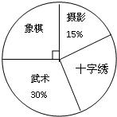

# Mathematics (Grade 6)

**ID**: f5371116
**难度**: hard
**题型**: multiple_choice

## 题目
如图是某校六年级学生选择摄影、象棋、武术、十字绣四个兴趣小组的扇形统计图，以下说法错误的是（  ）
A．参加武术小组的学生比参加摄影小组的多15\%
B．参加象棋小组的学生占六年级学生的$\frac{1}{4}$
C．参加武术小组与十字绣小组的学生人数相等
D．参加象棋小组与十字绣小组的人数之比为5：6

## 解答

**答案**: A

1. Step1:根据扇形统计图，确定摄影小组人数占总人数的15%，武术小组人数占总人数的30%
2. Step2:计算参加武术小组的学生比参加摄影小组的多的百分比，即(30% - 15%)÷15% = 100%，判断选项A错误
3. Step3:由象棋小组人数圆心角是90度，计算象棋小组人数占总人数的比例为90÷360 = 1/4，判断选项B正确
4. Step4:计算十字绣小组人数占总人数的比例为1 - 1/4 - 30% - 15% = 30%，与武术小组人数占比比较，30% = 30%，判断选项C正确
5. Step5:计算象棋小组与十字绣小组人数占比之比为1/4 : 30% = 25 : 30 = 5 : 6，判断选项D正确

## 知识点

**知识点**:
  - 扇形统计图；从统计图表中获取信息．

---
