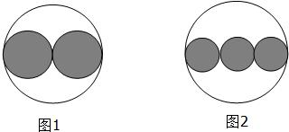

# Mathematics (Grade 6)

**ID**: f7f5ad83
**难度**: hard
**题型**: multiple_choice

## 题目
如图：图1阴影部分的面积和图2阴影部分面积的比是（  ）

A．1：1
B．2：3
C．3：2
D．不能确定

## 解答

**答案**: C

1. Step1:设图1阴影圆的半径为3r，图2阴影圆的半径为2r
2. Step2:根据圆的面积公式S = πr²，计算图1阴影部分的面积为π×（3r）²×2 = 18πr²
3. Step3:根据圆的面积公式S = πr²，计算图2阴影部分的面积为π×（2r）²×3 = 12πr²
4. Step4:求图1阴影部分面积和图2阴影部分面积的比，即18πr²：12πr² = 3：2

## 知识点

**知识点**:
  - 圆、圆环的面积；比的意义．

---
