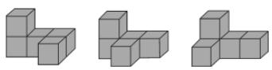

# Mathematics (Grade 6)

**ID**: ff8a5cad
**难度**: hard
**题型**: multiple_choice

## 题目
下列立体图形中，从（）看，形状是一样的。

A.左面和上面
B.上面和正面
C.正面和左面

## 解答

**答案**: C

1. Step1:明确题目是关于立体图形不同方向视图形状的判断
2. Step2:根据解析提示，需要从左面、上面、正面观察所给立体图形
3. Step3:观察发现从正面看到的形状是特定形状，从左面看到的形状也是相同的特定形状
4. Step4:对比选项，只有C选项是正面和左面，符合形状一样的情况，所以答案是C

## 知识点

**知识点**:
  - 

---
