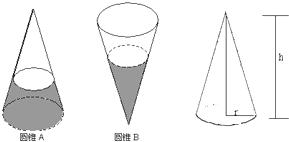

# Mathematics (Grade 6)

**ID**: 09e78c9a
**难度**: hard
**题型**: short_answer

## 题目
如图，A和B为两个全等的圆锥容器，将水分别倒入圆锥A和圆锥B中，使得这两个圆锥容器内的水位高度都正好是圆锥高度的一半，试求在圆锥A中水的体积和在圆锥B中水的体积的比。（圆锥的体积=$\frac{1}{3}$πr$^{2}$h，其中r为底圆的半径，h为圆锥的高） 

## 解答

**答案**: 7:1

1. Step1:设圆锥的底面半径为2r，高为2h
2. Step2:计算圆锥A中水的体积，由圆锥体积公式可知，大圆锥体积为$\frac{1}{3}$π(2r$^{2}$×2h，空白小圆锥体积为$\frac{1}{3}$πr$^{2}$h，所以圆锥A中水的体积为$\frac{1}{3}$π(2r$^{2}$×2h - $\frac{1}{3}$πr$^{2}$h = $\frac{7}{3}$πr$^{2}$h
3. Step3:计算圆锥B中水的体积，根据圆锥体积公式可得圆锥B中水的体积为$\frac{1}{3}$πr$^{2}$h
4. Step4:求圆锥A中水的体积与圆锥B中水的体积的比，即$\frac{7}{3}$πr$^{2}$h : $\frac{1}{3}$πr$^{2}$h，化简后得到7 : 1

## 知识点

**知识点**:
  - 圆锥的体积

---
