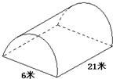

# Mathematics (Grade 6)

**ID**: 0b2a0352
**难度**: hard
**题型**: short_answer

## 题目
一位农民叔叔搭建了一个半圆柱形的蔬菜大棚，除去底面以外，其余部分用塑料薄膜围成，请根据相关数据计算：
（1）大棚的占地面积是多少平方米？
（2）至少需要多少平方米的塑料薄膜？

## 解答

**答案**: 126, 226.08

1. Step1:计算大棚的占地面积，根据长方形面积公式，长为21米，宽为6米，面积为21×6=126平方米
2. Step2:计算至少需要多少平方米的塑料薄膜，先根据圆柱表面积公式计算完整圆柱的表面积，其中侧面积为3.14×6×21，两个底面积为3.14×(6÷2)²×2，再将圆柱表面积除以2，即[3.14×6×21+3.14×(6÷2)²×2]÷2=(395.64+56.52)÷2=452.16÷2=226.08平方米

## 知识点

**知识点**:
  - 关于圆柱的应用题．

---
