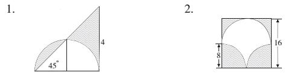

# Mathematics (Grade 6)

**ID**: 0b97661f
**难度**: hard
**题型**: short_answer

## 题目
计算下图中阴影部分的面积。（ 单位：厘米）

## 解答

**答案**: 4（平方厘米）, 128（平方厘米）

1. Step1:观察第一个图形，大三角形是等腰直角三角形，半圆直径为4厘米，连接半圆上面的相交点到半圆的右端点，将左边阴影部分旋转到连接线上面，空白部分是底4厘米、高2厘米的三角形，且为大三角形面积的一半，根据三角形面积公式S = 底×高÷2，可得大三角形面积为4×4÷2 = 8平方厘米，那么阴影部分面积为8÷2 = 4平方厘米
2. Step2:观察第二个图形，把下面两个1/4圆旋转后合起来是直径16厘米的半圆，平移到上面组成长16厘米、宽8厘米的长方形，根据长方形面积公式S = 长×宽，可得阴影部分面积为16×8 = 128平方厘米

## 知识点

**知识点**:
  - 三角形的面积;长方形与正方形的面积;组合图形的面积

---
