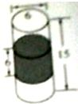

# Mathematics (Grade 6)

**ID**: 0ec1191a
**难度**: hard
**题型**: short_answer

## 题目
如图，把一个薯片筒放在桌子上．（单位：cm）
（1）这个薯片筒占据桌面的大小是多少平方厘米？
（2）已知这个薯片筒的标签宽度为6厘米（阴影部分），它的面积是多少平方厘米？（接头处忽略不计）

## 解答

**答案**: 28.26, 113.04

1. Step1:计算薯片筒的底面半径，由直径6cm可得半径为6÷2 = 3cm
2. Step2:计算薯片筒的底面积，根据圆的面积公式S = πr²，其中π取3.14，r = 3cm，所以底面积为3.14×3² = 3.14×9 = 28.26平方厘米，即薯片筒占据桌面的大小
3. Step3:计算薯片筒标签部分的侧面积，根据圆柱侧面积公式S = 底面周长×高，底面周长C = πd = 3.14×6cm，高为6cm，所以侧面积为3.14×6×6 = 3.14×36 = 113.04平方厘米

## 知识点

**知识点**:
  - 关于圆柱的应用题

---
