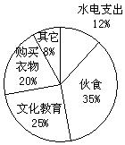

# Mathematics (Grade 6)

**ID**: 152bfa81
**难度**: hard
**题型**: short_answer

## 题目
聪聪家2015年11月支出情况统计如图．聪聪家2015年11月的总支出是3600元．请你回答问题：
（1）这个月哪项支出最多？支出了多少元？
（2）购买衣物的支出比文化教育支出少百分之几？少支出了多少元？

## 解答

**答案**: 1260, 20%, 180

1. Step1:从扇形统计图可知伙食支出占比35%最大，计算其支出金额，用总支出3600元乘以35%，即3600×35% = 1260元
2. Step2:计算购买衣物的支出比文化教育支出少的百分比，先算出两者占比差值25% - 20% = 5%，再用差值除以文化教育支出占比25%，即(25% - 20%)÷25% = 0.05÷0.25 = 20%
3. Step3:分别计算文化教育和购买衣物的支出金额，文化教育支出为3600×25% = 900元，购买衣物支出为3600×20% = 720元，然后计算两者差值900 - 720 = 180元

## 知识点

**知识点**:
  - 扇形统计图

---
