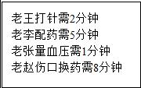

# Mathematics (Grade 6)

**ID**: 16494626
**难度**: hard
**题型**: short_answer

## 题目
老王、老李：老张、老赵四人同时来到社区医务室（医务室只有一名医生）．医生该怎样安排他们的就诊顺序，才能使四人的等候时间总和最少？最少要等几分钟？

## 解答

**答案**: 28

1. Step1:明确要使四人等候时间总和最少，需让花费时间短的病人先就诊，花费时间长的病人后就诊
2. Step2:比较四人看病所需时间，1分钟＜2分钟＜5分钟＜8分钟
3. Step3:确定就诊顺序为老张量血压→老王打针→老李配药→老赵伤口换药
4. Step4:计算等候时间总和，老张看病时4人都等，等候时间为1×4；老王看病时3人等，等候时间为2×3；老李看病时2人等，等候时间为5×2；老赵看病时无人等，等候时间为8，总和为1×4+2×3+5×2+8
5. Step5:计算1×4+2×3+5×2+8的结果，即4+6+10+8=28分钟

## 知识点

**知识点**:
  - 最佳方法问题．

---
