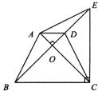

# Mathematics (Grade 6)

**ID**: 1683b1ec
**难度**: hard
**题型**: short_answer

## 题目
如图，等腰梯形ABCD中，交于O点的两条对角线互相垂直，三角形ECB是直角三角形，OC比AO长20厘米，已知三角形ADE的面积是250平方厘米，则梯形ABCD的面积为多少平方厘米？

## 解答

**答案**: 2450

1. Step1:因为梯形ABCD是等腰梯形，AC⊥BD，三角形ECB是直角三角形，所以得出三角形AOD和三角形EOC都是等腰直角三角形
2. Step2:由等腰直角三角形性质可得AO = DO，CO = EO = BO，又因为OC比AO长20厘米，所以AC - 2AO = DE = 20厘米
3. Step3:已知三角形ADE的面积是250平方厘米，根据三角形面积公式，可得AO×DE = 250×2 = 500平方厘米
4. Step4:把DE = 20厘米代入AO×DE = 500平方厘米，得到20AO = 500，解得AO = 25厘米
5. Step5:由AC - 2AO = 20厘米，AO = 25厘米，可得AC = 20 + 2×25 = 70厘米
6. Step6:因为等腰梯形对角线相等，所以BD = AC = 70厘米
7. Step7:根据对角线垂直的梯形的面积等于两条对角线乘积的一半，可得梯形ABCD面积 = $rac{1}{2}×AC×BD$ = $rac{1}{2}×70×70$ = 2450平方厘米

## 知识点

**知识点**:
  - 梯形的面积．

---
