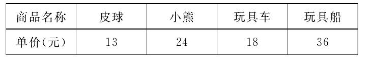

# Mathematics (Grade 6)

**ID**: 1b53c823
**难度**: hard
**题型**: short_answer

## 题目
解决问题。

1.买一辆玩具车和一辆玩具船需要多少元？
2.小丽买了一个皮球和一个小熊，花了多少钱？
3.玩具船比小熊贵多少元？
4.买一个小熊和一个玩具车一共需要多少元？
5.皮球比玩具车便宜多少元？

## 解答

**答案**: 54, 37, 12, 42, 5

1. Step1:计算买一辆玩具车和一辆玩具船的价格，将玩具车单价18元与玩具船单价36元相加，即18 + 36 = 54元
2. Step2:计算小丽买一个皮球和一个小熊的花费，把皮球单价13元与小熊单价24元相加，即13 + 24 = 37元
3. Step3:计算玩具船比小熊贵的金额，用玩具船单价36元减去小熊单价24元，即36 - 24 = 12元
4. Step4:计算买一个小熊和一个玩具车一共需要的钱数，将小熊单价24元与玩具车单价18元相加，即24 + 18 = 42元
5. Step5:计算皮球比玩具车便宜的金额，用玩具车单价18元减去皮球单价13元，即18 - 13 = 5元

## 知识点

**知识点**:
  - 整数的加法和减法

---
