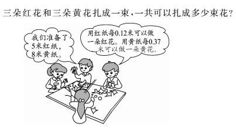

# Mathematics (Grade 6)

**ID**: 1c00e786
**难度**: hard
**题型**: short_answer

## 题目

三朵红花和三朵黄花扎成一束，一共可以扎成多少束花？
我们准备了5米红纸，8米黄纸。
用红纸每0.12米可以做一朵红花。用黄纸每0.37米可以做一朵黄花。

## 解答

**答案**: 7

1. Step1:计算5米红纸可做红花的数量，5÷0.12≈41（朵）
2. Step2:计算8米黄纸可做黄花的数量，8÷0.37≈21（朵）
3. Step3:计算红花可扎成的束数，41÷3=13（束）……2（朵）
4. Step4:计算黄花可扎成的束数，21÷3=7（束）
5. Step5:比较红花和黄花可扎成的束数，取较小值，确定一共可扎成7束花

## 知识点

**知识点**:
  - 小数除法;有余数的除法应用题

---
